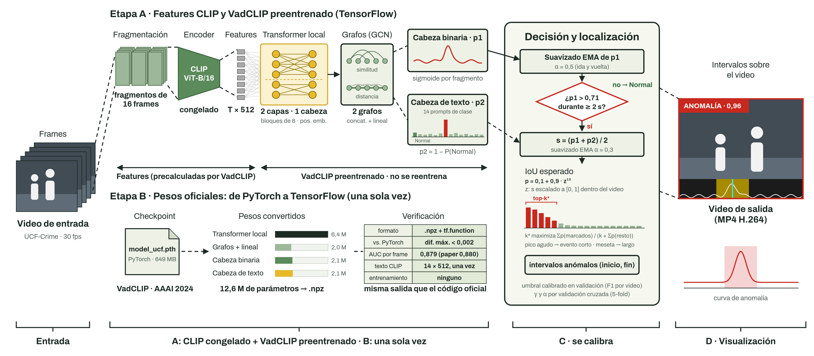

# Anomaly Detection in Surveillance Videos (TensorFlow)



Detects **whether** a surveillance video contains an anomalous event and **when** it happens. A pretrained VadCLIP model, ported to TensorFlow, gives anomaly scores to every 16-frame fragment. An expected-IoU rule turns those scores into anomalous time intervals, and the notebook renders an MP4 with the score, a red border during anomalies and a timeline at the bottom.

## How it works

| Step | What it does | Based on |
| --- | --- | --- |
| **1 · Features** | One CLIP feature (512-d) per 16-frame fragment. Precomputed VadCLIP features are used for UCF-Crime (crop 5 of 10); for your own videos they are extracted with the same preprocessing | Frozen CLIP ViT-B/16 (`open_clip`) |
| **2 · Scoring model** | Two scores per fragment: **p1** from a binary head and **p2** = 1 − P(Normal) from the alignment with 14 learned class prompts | VadCLIP pretrained weights, ported to TensorFlow: local-window Transformer (attention in blocks of 8 fragments) + feature-similarity and temporal-distance graph convolutions |
| **3 · Video decision** | A video is anomalous if the smoothed p1 stays above the threshold for at least 2 s | Forward-backward EMA smoothing, hysteresis, gap merging (≤ 5 s) and minimum duration (≥ 2 s) |
| **4 · Localization** | Inside an anomalous video, marks the fragments that maximize the expected IoU, using (p1 + p2) / 2 | Score min-max scaled within the video (z), turned into p = 0.1 + 0.9 · z<sup>γ</sup>; the top-k fragments are marked, with k maximizing Σp(marked) / (k + Σp(rest)) |
| **5 · Visualization** | Draws the score banner, anomaly border and score timeline on the video | OpenCV + Pillow |

The video threshold (0.71) is calibrated on the validation split by maximizing video-level F1. The validation split has no temporal labels, so the localization parameters (γ and the EMA factor) are chosen by 5-fold cross-validation over the test videos: each video is localized with parameters tuned on the other folds only.

### VadCLIP in TensorFlow

The model is not retrained. The official PyTorch checkpoint (`model_ucf.pth`) is converted once to `trabajo/modelo_tf/vadclip_ucf.npz`. The file holds 12.6 M parameters plus the 14 class-text embeddings, which are computed with the checkpoint's own CLIP text encoder. The network is rewritten with TensorFlow operations and reproduces the official code: the largest difference in p1 is below 0.002, and the frame AUC is 0.879 against the 0.880 reported in the paper.

### Training details

The notebook also trains a baseline model of its own, which appears in the results for comparison:

- **Model:** Keras Transformer encoder (2 layers, 8 heads, 512-d, max 256 fragments) with a temporal Conv1D (k = 3) before the attention and a sigmoid head. Full videos are scored with 50 %-overlapping windows.
- **Loss (weakly supervised, video-level labels only):** MIL top-k + bottom-k (lowest 60 % of an anomalous video), sparsity, smoothness and a normal-fragment term (every fragment of a normal video should be ~0).
- **Data split:** official UCF-Crime train/test lists; 15 % of the training videos (stratified by class) are held out for validation.
- **Batches:** balanced (half normal, half anomalous), with a random VadCLIP crop per video. Long videos are subsampled to 256 fragments with a random offset; short ones are padded.
- **Optimizer:** AdamW (lr 2e-5, weight decay 1e-2, gradient clipping 1.0), lr divided by 10 at epochs 4 and 8, 10 epochs.
- **Batch size:** 64, built from micro-batches of 16 with gradient accumulation.
- **Loading:** the notebook checks that every tensor in the weights file was loaded, so an architecture mismatch stops it instead of silently skipping layers.

## Results (UCF-Crime test set, 290 videos)

| Metric | VadCLIP + expected IoU | Baseline Transformer |
| --- | --- | --- |
| Frame AUC (standard UCF-Crime metric) | **0.874** | 0.840 |
| Video AUC (anomalous vs normal videos) | **0.971** | 0.964 |
| AUC inside anomalous videos (localization) | **0.687** | 0.609 |
| Mean IoU, detected vs ground truth (anomalous videos) | **0.245** | 0.212 |
| Ground-truth events detected (IoU ≥ 0.3) | **41.7 %** | 37.8 % |
| Detected intervals that match an event (IoU ≥ 0.3) | **23.0 %** | 18.0 % |
| Frame precision / recall / F1 | 0.169 / **0.727** / 0.274 | **0.240** / 0.674 / **0.354** |
| Normal videos with a false alarm | **6.7 %** | 8.0 % |

AUCs are computed on the smoothed score. The localization metrics of the VadCLIP column come from the 5-fold cross-validation described above.

Localization is the hard part: marking every fragment of every anomalous video would already give a mean IoU of 0.217, while the best per-video threshold, chosen by looking at the labels, would reach 0.43 with the same scores. The model ranks fragments well, but deciding how much of each video to mark is still the bottleneck.

## Setup

```bash
python -m venv .venv
source .venv/bin/activate
pip install -r requirements.txt
```

## Data

The datasets are **not included** in this repository. Download them from their original sources:

| Data | Source | Required for |
| --- | --- | --- |
| VadCLIP CLIP features for UCF-Crime (`UCFClipFeatures/`) |  [VadCLIP README](https://github.com/nwpu-zxr/VadCLIP) ("CLIP" column) | Training and evaluation |
| Official lists (`list/` folder) | [VadCLIP repo](https://github.com/nwpu-zxr/VadCLIP) (cloned automatically if the path is empty) | Splits and test ground truth |
| VadCLIP UCF-Crime checkpoint (`model_ucf.pth`) | [VadCLIP README](https://github.com/nwpu-zxr/VadCLIP) ("Model" column) | First run only: converted to `trabajo/modelo_tf/vadclip_ucf.npz` |
| UCF-Crime videos | [Official UCF-Crime release](https://www.crcv.ucf.edu/projects/real-world/) | Demo only |

Training and evaluation use only the features and the converted VadCLIP weights. After the first run, copying `vadclip_ucf.npz` (50 MB) is enough; the 649 MB checkpoint is no longer needed. You don't need the UCF-Crime videos (~100 GB) unless you want to render the demo on them; any other video works too.


## License

This code is released under the **AGPL-3.0** license.

The datasets keep their own terms and are intended for **academic and research use only**. UCF-Crime contains real footage of people; please respect their privacy when sharing results.

## Citations

If you use this work, please cite the resources it builds on:

- **UCF-Crime**: W. Sultani, C. Chen, M. Shah. *Real-world Anomaly Detection in Surveillance Videos*. CVPR 2018.
- **VadCLIP**: P. Wu et al. *VadCLIP: Adapting Vision-Language Models for Weakly Supervised Video Anomaly Detection*. AAAI 2024.
- **CLIP**: A. Radford et al. *Learning Transferable Visual Models From Natural Language Supervision*. ICML 2021.
