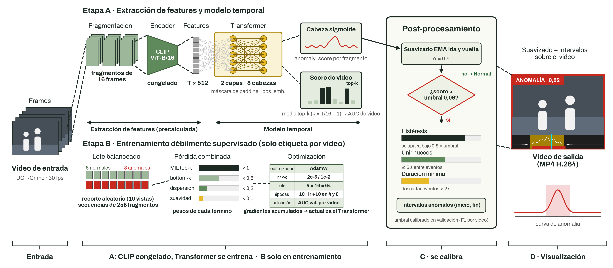

# Anomaly Detection in Surveillance Videos (TensorFlow)



Detects **whether** a surveillance video contains an anomalous event and **when** it happens. The model gives an anomaly score to every 16-frame fragment, turns those scores into anomalous time intervals, and renders an MP4 with the score, a red border during anomalies and a timeline at the bottom.

## How it works

| Step | What it does | Based on |
| --- | --- | --- |
| **1 · Features** | One CLIP feature (512-d) per 16-frame fragment. Precomputed VadCLIP features are used for UCF-Crime; for your own videos they are extracted with the same preprocessing | Frozen CLIP ViT-B/16 (`open_clip`) |
| **2 · Temporal model** | Scores each fragment from 0 (normal) to 1 (anomalous) | Keras Transformer encoder (2 layers, 8 heads, 512-d, max 256 fragments) + sigmoid head |
| **3 · Training** | Weakly supervised: only video-level labels (normal / anomalous) are used | MIL top-k loss + bottom-k, sparsity and smoothness terms |
| **4 · Post-processing** | Converts fragment scores into intervals | Forward-backward EMA smoothing, hysteresis threshold, gap merging (≤ 5 s) and minimum duration (≥ 2 s) |
| **5 · Visualization** | Draws the score banner, anomaly border and score timeline on the video | OpenCV + Pillow |

The detection threshold is calibrated on the validation split by maximizing video-level F1, and is saved together with the weights.

### Training details

- **Data split:** official UCF-Crime train/test lists; 15 % of the training videos (stratified by class) are held out for validation.
- **Batches:** balanced (half normal, half anomalous), with a random VadCLIP crop per video. Long videos are compressed to 256 fragments by averaging; short ones are padded.
- **Optimizer:** AdamW (lr 2e-5, weight decay 1e-2, gradient clipping 1.0), lr divided by 10 at epochs 4 and 8, 10 epochs.
- **Batch size:** 64, built from micro-batches of 16 with gradient accumulation.

## Results (UCF-Crime test set, 290 videos)

| Metric | Value |
| --- | --- |
| Frame AUC (standard UCF-Crime metric) | 0.694 |
| Video AUC (anomalous vs normal videos) | 0.978 |
| AUC inside anomalous videos (localization) | 0.589 |
| Mean IoU, detected vs ground truth (anomalous videos) | 0.244 |
| Ground-truth events detected (IoU ≥ 0.3) | 39.1 % |
| Detected intervals that match an event (IoU ≥ 0.3) | 14.7 % |
| Frame precision / recall / F1 | 0.276 / 0.488 / 0.352 |
| Normal videos with a false alarm | 10.0 % |

## Setup

```bash
python -m venv .venv
source .venv/bin/activate
pip install -r requirements.txt
```

## Data

The datasets are **not included** in this repository. Download them from their original sources:

| Data | Source | Required for |
| --- | --- | --- |
| VadCLIP CLIP features for UCF-Crime (`UCFClipFeatures/`) |  [VadCLIP README](https://github.com/nwpu-zxr/VadCLIP) | Training and evaluation |
| Official lists (`list/` folder) | [VadCLIP repo](https://github.com/nwpu-zxr/VadCLIP) | Splits and test ground truth |
| UCF-Crime videos | Official UCF-Crime release | Demo only |

Training and evaluation use only the features. You don't need the UCF-Crime videos (~100 GB) unless you want to render the demo on them; any other video works too.


## License

This code is released under the **AGPL-3.0** license.

The datasets keep their own terms and are intended for **academic and research use only**. UCF-Crime contains real footage of people; please respect their privacy when sharing results.

## Citations

If you use this work, please cite the resources it builds on:

- **UCF-Crime**: W. Sultani, C. Chen, M. Shah. *Real-world Anomaly Detection in Surveillance Videos*. CVPR 2018.
- **VadCLIP**: P. Wu et al. *VadCLIP: Adapting Vision-Language Models for Weakly Supervised Video Anomaly Detection*. AAAI 2024.
- **CLIP**: A. Radford et al. *Learning Transferable Visual Models From Natural Language Supervision*. ICML 2021.
